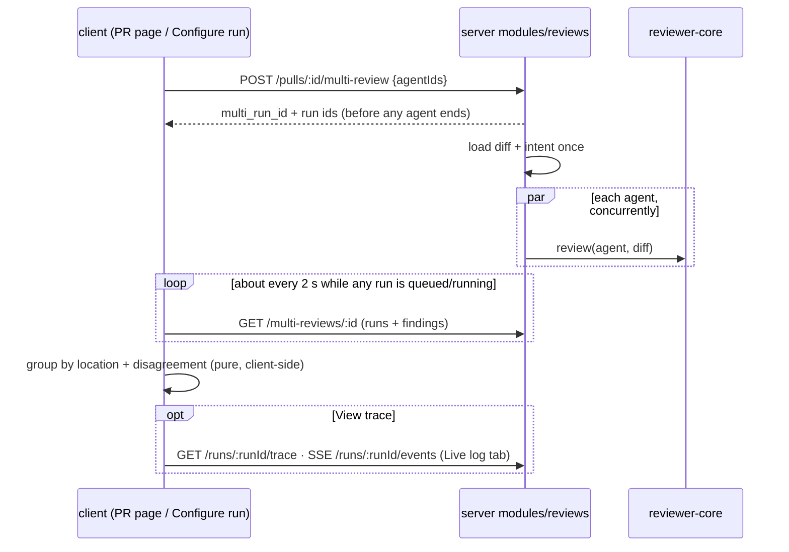

# Spec: Multi-Agent Review — run several reviewer agents on one PR, group their findings, show where they disagree
Spec ID: SPEC-2026-10-11-multi-agent-review
Status: approved
Supersedes: none
Packages: server, client, e2e

## Problem and user
A reviewer looking at one PR that mixes a security risk, a performance problem and a domain-rule break gets the widest coverage from several specialised agents, but today they can only start one agent at a time, or "all enabled", from the PR page. They then read each agent's run separately and compare them by hand. Nothing tells them which findings are the same issue said twice, where one agent flagged something another ignored, or what the combined run cost before and after they start it. The reviewer needs to choose the agents, see the price up front, watch every agent live, and get one results view. That view has to remove duplicates without hiding who said what, show disagreements, and show the real cost.
**Request vs tree:** the premise holds in part. `multi_agent_runs` exists but nothing writes it, and `agent_runs` has no link to it (server/src/db/schema/runs.ts:17-56, :69-86). The current review path takes a list of agents, but it runs them **one after another** (server/src/modules/reviews/run-executor.ts:134). Only the diff load and the intent are shared once (run-executor.ts:104-132), so "reuse the machinery" needs a concurrent fan-out. Per-agent averages exist as a contract (`AgentStats`, server/src/vendor/shared/contracts/observability.ts:96), but no route serves it (server/src/modules/agents/routes.ts:90-219). The nav has no "Multi-Agent Review" item (client/src/vendor/ui/nav.ts:20-38), although strings for one are left over (client/messages/en/runs.json:109-133).

## Goals / Non-goals
**Goals**
- A reviewer starts N chosen agents on one PR in one action, from the PR page or from a Configure run screen that shows time and cost estimates taken from past runs.
- The agents run concurrently. Each agent's status refreshes on its own while the run is in flight, and one agent failing leaves the others' results intact.
- One results page in two modes (Columns, Tabs + detail) shows the real total time and cost, the match groups of similar findings with every original kept, and a "Where agents disagree" block.
- Each agent's trace and live log open in the same drawer the PR page uses.
- The 1-agent vs 3-agent cost and time are measured and recorded, not assumed.

**Non-goals**
- Any change under `ci/` or `agent-runner/`, or to `POST /pulls/:id/review` and its `RunRequest` contract.
- Per-agent explanations for "did not flag" (they would need an extra LLM call; this is a user decision). The design's notes, such as "Not a security concern.", are deliberately not built.
- The finding "Learn" action. The Memory feature is unbuilt (DR-6).
- LLM-based deduplication or semantic similarity. Grouping is deterministic (AC-13).
- A list or history of past multi-agent runs. Fan-out through git worktrees.
- Storing a colour or icon on the agent. The look is a fixed client-side map keyed by agent name, with no database or contract change (AC-18, DR-7).
- The "+N agents" group badge (DR-18), which was not adopted (Q-5).

**Simplicity constraints** (user requirement: "keep it simple, don't overcomplicate")
- No new SSE channel. Column status comes from re-reading the multi-run, and SSE stays only inside the reused trace drawer's Live log tab.
- No LLM call beyond each agent's own review.
- No grouping on the server and no grouping contract on the wire. Grouping and disagreement are computed on the client from the runs and findings the read returns.
- No new tables: the existing `multi_agent_runs` table plus one link from each agent run to it.
- No full history list of multi-runs. The way back to a multi-run's results is the per-run link in the PR run history (AC-17). No new UI states beyond those listed in this spec.

## User stories
- **US-1** As a reviewer on a PR page, I want to tick several agents and run them together so that I do not start them one by one.
- **US-2** As a reviewer, I want to pick a PR and agents on one screen with time and cost estimates from past runs so that I know the price before I spend it.
- **US-3** As a reviewer, I want each agent's result side by side with its live status, score, time and cost so that I can compare agents and see a partial result when one of them fails.
- **US-4** As a reviewer, I want findings that several agents raised about the same thing to be grouped, with every author and original text still reachable, so that I read each issue once without losing attribution.
- **US-5** As a reviewer, I want to see, location by location, which agents flagged it and which did not so that I can judge the disagreements.
- **US-6** As a reviewer, I want to open any agent's trace and live log from the results page so that I can explain its tokens, its cost and the grounding gate's decisions.
- **US-7** As the product owner, I want measured 1-agent vs 3-agent numbers so that the cost of wider coverage is stated from data.

## Acceptance criteria (EARS)
- **AC-1** WHEN the user opens "Run Review" on a PR page, the dropdown shall show the header "PICK AGENTS TO RUN" with a "Select all"/"Clear" switch. Below it come one checkbox row per enabled agent, with the agent's name and a time hint from its past runs, then the run button and a "Configure agents…" link. For a merged or closed PR, the existing merged warning stays above the list. · traces: US-1 · verify: component
- **AC-2** The dropdown's run button shall read "Select an agent" (disabled) with none checked, and "Run <agent name>" with one checked, which starts the existing single-agent run unchanged. With N ≥ 2 checked it shall read "Run multi-agent review (N)". · traces: US-1 · verify: component
- **AC-3** WHEN the user activates "Run multi-agent review (N)" in the dropdown, the system shall start one multi-agent run on that PR with exactly the checked agents and open its results page. · traces: US-1 · verify: component
- **AC-4** WHEN the user opens "Multi-Agent Review" from the sidebar, the system shall show "Run a Multi-Agent Review" with step 1 "Pull request": a dropdown of the active repository's PRs as "#<number> · <title>". Until a PR is picked, step 2 "Agents to run" shall show the empty state "Pick a pull request first", and the run button shall be disabled. · traces: US-2, DR-3, DR-14 · verify: e2e
- **AC-5** WHILE a PR is picked, the Configure run screen shall list every enabled agent as a checkbox card with its name, its description and an estimate "<seconds>s · $<cost>". The estimate is the average duration and the average known cost of that agent's past completed runs. A "Select all"/"Clear all" switch sits next to the list. · traces: US-2, DR-2 · verify: component
- **AC-6** WHILE a PR and at least one agent are picked, the Configure run screen shall show "≈ <max estimated seconds>s · $<sum of estimated costs> · parallel fan-out" next to the run button. The button reads "Run multi-agent review (N)" for N ≥ 2, "Run 1 agent" for one and "Select agents" (disabled) for none. · traces: US-2 · verify: component
- **AC-7** WHEN `POST /pulls/:id/multi-review` receives a valid request, the server shall create one multi-agent run for the PR plus one agent run per requested agent, each recorded as belonging to it. It shall return their ids before any agent finishes. · traces: US-1, US-2, DR-1 · verify: integration
- **AC-8** WHEN a review is started through `POST /pulls/:id/review`, the server shall accept the same body and return the same response shape as before, and the started runs shall belong to no multi-agent run. · traces: US-1 · verify: integration
- **AC-9** The results page shall show "Configure run", the title "Multi-Agent Review", "<N> selected agents · parallel", a Columns/Tabs switch and a meta row "#<number> <title>" … "<N> agents · parallel fan-out · <T>s total · $<C>". T is the wall time from start to the last agent's end, and C is the sum of the completed runs' costs. · traces: US-3, DR-14 · verify: component
- **AC-10** WHILE any agent run of the multi-run is queued or running, the results page shall re-read the multi-run about every 2 seconds and show each column's current status without a manual reload. It shall stop re-reading once every run has ended. Once a run completes, the column shows the score ring, "<s>s · $<c>", mini findings (severity, title, `file:line`) and a footer with "View trace" and "<k> findings". · traces: US-3, DR-8 · verify: component
- **AC-11** WHERE the Tabs mode is selected, the results page shall show one tab per agent with its name and score. The selected tab shows a header (score ring, name, summary, "View trace", "<s>s · $<c>") above the agent's full finding cards: confidence, suggested fix, Accept, Dismiss, Turn into eval case. Each action changes the same finding the PR page shows. · traces: US-3, DR-12 · verify: component
- **AC-12** WHEN the user activates "View trace" for an agent on the results page, the system shall open that run in the same trace drawer the PR page uses. The Trace tab has Configuration, Stats (tokens in/out, cost, grounding), Prompt assembly, Tool calls and Raw output with "Copy raw output". The Live log tab streams while the run is running, opens first in that case, and includes the grounding gate's per-finding drop lines. · traces: US-6, DR-5, DR-10 · verify: component
- **AC-13** The system shall put two findings from different agents of one multi-run into the same match group when two conditions hold: they are in the same file path, and their line ranges overlap once each range is widened by 3 lines on both sides. Title and category play no part. Groups are the connected components of this relation; a finding that matches nothing is a group of one. The same findings in any input order produce the same groups. · traces: US-4, DR-4 · verify: unit
- **AC-14** The "Where agents disagree" block shall show one row per location. A location is exactly one AC-13 group, including a group of one finding. Each row is headed by `file:line` and the title of its highest-severity finding. Each flagged agent's cell shows that agent's severity and original title, and on activation its original rationale and line range, unchanged. · traces: US-4, US-5, DR-13 · verify: component
- **AC-15** In each location row, the system shall show one cell for every agent selected for the multi-run and only those. An agent whose completed run has no finding in that location reads "did not flag", with no explanation text. While "Show only conflicts" is on, rows where every completed agent gave the same severity shall be hidden. · traces: US-5, DR-14, DR-17 · verify: component
- **AC-16** WHEN the implementation is done, a person shall follow these steps. (1) `./scripts/dev.sh`, then open the demo PR #482. (2) Run a multi-agent review with 3 agents and check the columns, the location rows and the disagreement block. (3) Run the same PR with 1 agent through the Configure run screen. (4) Record in `docs/multi-agent-review-benchmark.md`, for both runs: wall time, tokens in/out, cost, findings count and the number of match groups, plus the ratio as measured. The conclusion is not tuned toward 3×; shared preparation, caching and response length are named as possible causes of any gap. · traces: US-7 · verify: manual
- **AC-17** The PR page run history shall show an "Open multi-agent results" link on every agent run that belongs to a multi-agent run, leading to that multi-run's results page. A run that belongs to none shall show no new element. · traces: US-3, DR-19 · verify: component
- **AC-18** The system shall draw each agent with a fixed icon and colour in the picker rows and cards, the column headers, the tabs and the disagreement cells, chosen by the agent's exact name: Security Reviewer → shield, red; Performance Reviewer → lightning, amber; Test Quality Reviewer → lightbulb, blue; API Contract Reviewer → users, purple; General Reviewer → boxes, green; any other name → a neutral icon and a neutral colour. The agent's name is always shown next to the icon. · traces: US-3, DR-7 · verify: component

## Edge cases
- **EC-1** IF one agent run of a multi-run fails or is cancelled, THEN the server shall still run the other agents to completion and persist their reviews. · traces: US-3 · verify: integration
- **EC-2** IF an agent run ends failed or cancelled, THEN its column shall show that status and the error text, keep "View trace", and leave the other columns and the meta row showing their own results. · traces: US-3, DR-8 · verify: component
- **EC-3** IF the shared preparation (loading the PR diff) fails, THEN every agent run of the multi-run shall end failed with that reason, and every column shall show failed instead of staying running. · traces: DR-8 · verify: integration
- **EC-4** IF the request body is not `{agentIds}` with 1–10 unique non-empty strings and no other key, THEN the server shall answer 422 naming the field and create nothing. · traces: DR-1 · verify: integration
- **EC-5** IF the PR or any requested agent is not in the caller's workspace, THEN the server shall answer 404 and create no multi-agent run and no agent run. · traces: DR-1 · verify: integration
- **EC-6** IF an agent has no completed past run, or none with a known cost, THEN its estimate shall show "—" for the missing figure. The aggregate shall leave it out of the time maximum and show its cost as "—", never counting unknown as $0. · traces: DR-11 · verify: component
- **EC-7** IF a completed agent run has an unknown cost, THEN its column shall show "—" for cost and the meta row total shall show "—". · traces: US-3 · verify: component
- **EC-8** IF the results page is opened or reloaded while agent runs are in flight, THEN it shall show each run's current status from the server and resume the periodic re-read of AC-10. · traces: DR-9 · verify: component
- **EC-9** IF the results page is opened for an unknown multi-run id, or one from another workspace, THEN it shall show a not-found state with a link to Configure run. · traces: DR-9 · verify: component
- **EC-10** WHILE a multi-run start request is in flight, the run buttons in the dropdown and on Configure run shall be disabled, so one click starts one multi-agent run. · traces: DR-16 · verify: component
- **EC-11** IF an agent's run failed or was cancelled, THEN its cell in every location row shall read "no result" rather than "did not flag", and the cell shall not count toward a conflict. · traces: DR-15 · verify: component
- **EC-12** IF the workspace has no enabled agent, THEN the dropdown and Configure run shall show a one-line empty state, "Enable agents to run reviews", with a "Go to Agents" link. · traces: DR-16 · verify: component

## Design review
**Source:** specs/designs/multi-agent-review/ (01–04 PNG, source/*.jsx); the checklist was run per screen against the design and the tree.
### Gaps
- **DR-1** Nothing creates a multi-agent run or links agent runs to one. `multi_agent_runs` is unused and the executor loops agents sequentially (server/src/db/schema/runs.ts:69; server/src/modules/reviews/run-executor.ts:134). A generated migration is expected.
- **DR-2** No route serves per-agent history averages. `AgentStats` (observability.ts:96) has no route, so the "~6s" hint and the estimates have no source today.
- **DR-3** No Multi-Agent Review route or sidebar item exists (client/src/vendor/ui/nav.ts:20-38, which the app owns per client/AGENTS.md). Only stale strings exist (client/messages/en/runs.json:109-133, shell.json:26).
- **DR-4** No similarity or dedup heuristic exists in the tree. The request leaves its definition to this spec; AC-13 sets a location-only rule with one tunable constant (±3 lines).
- **DR-5** The trace drawer lives under the PR route (client/src/app/repos/[repoId]/pulls/[number]/_components/RunTraceDrawer, mounted at …/page.tsx:229). Shared code may not import a route (client/AGENTS.md), so another route can use it only after it moves to a shared location (frontend-ui-architecture). That move is the only change to the drawer: no new drawer and no fork. This is a constraint, not a plan.
- **DR-6** "Learn" is in the design's action row with no handler (source/findings.jsx:23). The card in the tree has Accept, Dismiss and Turn into eval case only (…/FindingCard/FindingCard.tsx:120-141). It is out of scope; see Q-4.
- **DR-7** The design gives each persona a colour and icon (source/data.jsx:446-460: Security/Shield/#ef4444, Performance/Zap/#f59e0b, Junior Mentor/Lightbulb/#3b82f6, Customer-Facing/Users/#8b5cf6, Architecture/Boxes/#10b981). Agents carry neither (server/src/db/schema/agents.ts). The seeded names differ from the design's (server/src/db/seed.ts:210-254: General, Security, Performance, Test Quality and API Contract Reviewer). Only Security and Performance match directly. The other three take the remaining design looks by closest role (Q-9), and nothing is stored. Renaming a seeded agent, or creating a new one, falls back to the neutral look → AC-18.
### Uncovered cases
- **DR-8** The queued, running, failed and cancelled column states are not drawn, and neither is a shared-preparation failure → AC-10, EC-2, EC-3.
- **DR-9** No results-page loading, reload-mid-run or not-found state is drawn. The source has only "No agents selected" → EC-8, EC-9.
- **DR-10** "View trace" is drawn, but the drawer it opens is not → AC-12.
- **DR-11** There is no estimate for an agent with no past runs, and design 01 hard-codes "~6s" (source/components2.jsx:96) → EC-6.
- **DR-12** The Tabs + detail mode has no screenshot, only source (source/screen_multiagent.jsx:72-102) → AC-11.
- **DR-13** Match groups appear nowhere in the design. Columns show only per-agent minis → AC-14 (groups surface as location rows), DR-18.
- **DR-14** The design contradicts itself in three places. PNG 02 shows an enabled "Run multi-agent review (4)" with no PR, while the source disables it (screen_multiagent.jsx:154). PNG 04's disagreement rows list Architecture, which was not selected (data.jsx:469). MetaRow says "fan-out via worktrees" (screen_multiagent.jsx:49), but execution is in-process. The spec follows the source and the selection → AC-4, AC-9, AC-15.
- **DR-15** A failed agent in the disagreement block is not drawn → EC-11.
- **DR-16** Double submit and the no-enabled-agents state are not drawn → EC-10, EC-12.
- **DR-17** Deliberate deviation: "did not flag" cells carry no note, unlike data.jsx:468-475 (a user decision: no extra LLM call) → AC-15.
### Module interactions
| From | To | Through | Contract |
|---|---|---|---|
| `client` PR page dropdown, Configure run | `server` `modules/reviews` | `POST /pulls/:id/multi-review` | `MultiReviewRequest {agentIds}` → `MultiReviewStarted {multi_run_id, pr_id, runs[{run_id, agent_id, agent_name}]}` in server/src/vendor/shared/contracts/platform.ts · new (mirrored to client/src/vendor/shared) |
| `client` PR page run history | `server` `modules/reviews` | `GET /pulls/:id/runs` (reviews/routes.ts:101) | `RunSummary` (trace.ts:118) · existing, plus an additive nullable `multi_run_id` field (mirrored to client/src/vendor/shared) |
| `client` results page (re-read about every 2 s while a run is in flight) | `server` same module | `GET /multi-reviews/:id` | `MultiReviewDetail {id, pr, ran_at, agents[{run: RunSummary, summary, findings: FindingRecord[]}]}`, with no grouping on the wire · new, built on `RunSummary` (trace.ts:118) and `FindingRecord` (review-api.ts:15) · existing |
| `client` dropdown hint, Configure run (one shared read) | `server` `modules/agents` | `GET /agents/run-estimates` | `AgentRunEstimate[] {agent_id, sample_runs, avg_duration_ms \| null, avg_cost_usd \| null}` over each agent's last 20 completed runs · new; `AgentStats` is not used |
| `server` multi-review | `server` `modules/reviews` run path | in-process | The minimal shape: one `multi_agent_runs` row (existing table), then the existing review service and executor with the chosen targets. Each agent run carries one nullable, indexed link to its multi-run (a generated migration). The only executor change is that the per-agent loop runs concurrently after the shared diff and intent preparation, keeping per-agent failure isolation |
| `client` Configure run | `server` `modules/pulls` | `GET /repos/:id/pulls` (pulls/routes.ts:33) | `PrMeta` · existing |
| `client` results page, trace drawer only | `server` `modules/reviews` | `GET /runs/:id/events` (SSE, Live log tab only), `GET /runs/:id/trace` | `RunEvent`, `RunTrace` in trace.ts · existing |
| `client` results page, Tabs mode | `server` `modules/reviews` | `POST /findings/:id/accept\|dismiss` | existing |
| `client` results page | `server` `modules/evals` | `POST /findings/:id/eval-case` (evals/routes.ts:109) | existing |
| `server` multi-review | `reviewer-core` | the existing run executor, per agent, concurrently | `Review`/`Finding` in findings.ts · existing |

### UX improvements
- **DR-18** *proposed, not adopted* (Q-5): a mini finding in Columns mode that belongs to a group with other agents shows a "+N" badge naming those agents. Motivated by US-4 and DR-13. It stays listed so its ID remains valid.
- **DR-19** *adopted* (2026-10-11): the PR page run history links each run that belongs to a multi-agent run to its results page. This is the way back to the results, given there is no history list → AC-17.

## Non-functional requirements
- **NFR-1** Concurrency: the agent runs of one multi-run shall overlap in time, so that with three agents the multi-run's wall time is less than the sum of the three runs' durations. · verify: integration
- **NFR-2** Cost: a multi-run shall make no model call beyond each agent's own review calls. The diff load and the intent run once per multi-run, and grouping and disagreement are computed on the client with no LLM. · verify: integration
- **NFR-3** Size and rate: `POST /pulls/:id/multi-review` shall accept at most 10 agents and at most 10 requests per minute, the same limit as `POST /pulls/:id/review` (server/src/modules/reviews/routes.ts:29). · verify: integration
- **NFR-4** i18n: every new user-facing string shall come from `client/messages/en/<namespace>.json`. · verify: static
- **NFR-5** Accessibility: every agent row is a checkbox with the agent's name as its accessible name and toggles from the keyboard. The Columns/Tabs switch and "Show only conflicts" have accessible names and pressed or checked state. Every run status and severity is shown as text, not only as colour. · verify: component
- **NFR-6** Data retention: a multi-run and its agents' membership shall survive a page reload and a server restart. Deleting the PR removes them. Deleting one agent run from the PR history leaves the multi-run and its other runs readable. · verify: integration
- **NFR-7** Degraded mode: on an unindexed repo each agent shall run diff-only exactly as a single review does, with no multi-run-specific error. · verify: integration
- **NFR-8** Layout: with more than 5 agents, or on a viewport narrower than the columns, each column shall keep at least 220 px and the row shall scroll horizontally without overlap. · verify: manual (open a 6-agent results page at 1024 px width and look)
- **NFR-9** Boundaries: the change shall touch no file under `ci/` or `agent-runner/`. · verify: static

## Traceability
| Requirement | Traces to | Verify how |
|---|---|---|
| AC-1 | US-1 | component |
| AC-2 | US-1 | component |
| AC-3 | US-1 | component |
| AC-4 | US-2, DR-3, DR-14 | e2e |
| AC-5 | US-2, DR-2 | component |
| AC-6 | US-2 | component |
| AC-7 | US-1, US-2, DR-1 | integration |
| AC-8 | US-1 | integration |
| AC-9 | US-3, DR-14 | component |
| AC-10 | US-3, DR-8 | component |
| AC-11 | US-3, DR-12 | component |
| AC-12 | US-6, DR-5, DR-10 | component |
| AC-13 | US-4, DR-4 | unit |
| AC-14 | US-4, US-5, DR-13 | component |
| AC-15 | US-5, DR-14, DR-17 | component |
| AC-16 | US-7 | manual |
| AC-17 | US-3, DR-19 | component (integration for the `multi_run_id` field) |
| AC-18 | US-3, DR-7 | component |
| EC-1 | US-3 | integration |
| EC-2 | US-3, DR-8 | component |
| EC-3 | DR-8 | integration |
| EC-4 | DR-1 | integration |
| EC-5 | DR-1 | integration |
| EC-6 | DR-11 | component |
| EC-7 | US-3 | component |
| EC-8 | DR-9 | component |
| EC-9 | DR-9 | component |
| EC-10 | DR-16 | component |
| EC-11 | DR-15 | component |
| EC-12 | DR-16 | component |
| NFR-1 | US-3 | integration |
| NFR-2 | US-7 | integration |
| NFR-3 | US-1 | integration |
| NFR-4 | US-2 | static |
| NFR-5 | US-1, US-5 | component |
| NFR-6 | US-3 | integration |
| NFR-7 | US-3 | integration |
| NFR-8 | US-3 | manual |
| NFR-9 | US-1 | static |

DR-6 is owned by Non-goals and Q-4. DR-18 is a proposal that was not adopted (Q-5).

## Inputs and provenance
| Source | Path or URL | What it settled |
|---|---|---|
| request | caller brief, 2026-10-11 | Product goal, scope of worktree A, the 1-vs-3 measurement, the reuse of `LiveLogStream` and `RunTraceDrawer`, and the boundary that `ci/` and `agent-runner/` stay untouched |
| answers | "a SEPARATE endpoint … `POST /pulls/:id/multi-review` with `{agentIds}` … `/review` stays unchanged" | AC-7, AC-8, EC-4 |
| answers | "no ready heuristic … same file + overlapping lines ±N + similar title/category" | AC-13 (first draft; narrowed by the revision below) |
| answers | coordinator revision, 2026-10-11: "keep it simple, don't overcomplicate" + "accepted all defaults Q-1..Q-8" | Location-only grouping (AC-13, AC-14); client-side grouping with no grouping contract; periodic re-read instead of per-column SSE (AC-10, EC-8); one nullable link column plus a concurrent executor loop; `GET /agents/run-estimates`; the drawer promoted, not forked (DR-5); Simplicity constraints; Q-1…Q-8 resolved |
| answers | coordinator revision 3, 2026-10-11: the user approved "ADOPT DR-19" and a "fixed client-side presentation map keyed by agent NAME" | AC-17 with the additive `multi_run_id` on `RunSummary`; AC-18; DR-7 and DR-19 updated; Q-3 re-resolved; Q-9 |
| answers | "'did not flag' is shown WITHOUT an explanation note" | AC-15, DR-17 |
| answers | "View trace … opens the SAME side drawer used on the PR page" | AC-12, DR-5 |
| answers | "the numbers go in a separate docs file … written after implementation" | AC-16 |
| design | specs/designs/multi-agent-review/01–04 PNG, source/screen_multiagent.jsx, components2.jsx:68-112, data.jsx:446-475, findings.jsx:19-25, screen_trace.jsx | Labels, states, layout, and the DR-6…DR-17 findings |
| repo | server/src/modules/reviews/run-executor.ts:63-163 | Shared diff and intent run once, agents loop sequentially, pre-work failure fails every run → EC-3, NFR-1 |
| repo | server/src/modules/reviews/service.ts:103-141 | Run rows are created up front and executed fire-and-forget, with failures isolated per agent → AC-7, EC-1 |
| repo | reviewer-core/src/review/run.ts:207-208 | Grounding drops are emitted to the live log with reasons → AC-12 |
| repo | client/src/app/repos/[repoId]/pulls/[number]/_components/RunReviewDropdown/RunReviewDropdown.tsx:42-80 | Current dropdown: Run all, every agent including disabled ones, the merged warning, Configure agents → AC-1, Q-1 |
| insights | INSIGHTS.md:292-297 | Unknown cost renders "—" and is never added as 0 → EC-6, EC-7 |
| insights | server/INSIGHTS.md:169-172 | A failed or cancelled run stores a null cost, so it is excluded from totals → AC-9, EC-2 |
| insights | server/INSIGHTS.md:449-452 | The trace is written before the terminal status, so the drawer can read it on "done" → AC-12 |
| insights | server/INSIGHTS.md:192-200 | A new FK column needs a deliberate index decision → NFR-6 (for the planner) |
| insights | client/INSIGHTS.md:158-166 | RunTraceDrawer's import shape is tied to the PR route → DR-5 |

## Untrusted inputs
| Input | Source | Validation | On invalid |
|---|---|---|---|
| `agentIds` body | HTTP client | Shape and bounds: a strict object, 1–10 unique non-empty strings | 422 naming `agentIds`; nothing created |
| each agent id, `:id` PR param | HTTP client | Identity: resolves within the caller's workspace | 404; nothing created |
| `:id` multi-run param | URL of the results page | Identity: resolves within the caller's workspace | 404 → not-found state (EC-9) |
| finding title, rationale, suggestion | LLM output | Text that is rendered: titles as plain text, rationale and suggestion only through the existing markdown renderer | Rendered as text, never as raw HTML |
| PR title, agent name and description | GitHub, user form | Text that is rendered: plain text | Rendered as text; overflow is truncated with an ellipsis |
| live-log lines, raw output | LLM output and run events over SSE | Text that is rendered: plain text; copy goes to the clipboard verbatim | Rendered as text |

## Open questions
- None outstanding.

**Resolved decisions** (2026-10-11, the user through the coordinator: "keep it simple"; all defaults accepted)
- Q-1, resolved: the dropdown lists enabled agents only, as in the design (AC-1).
- Q-2, resolved: all enabled agents start preselected in the dropdown and on Configure run (AC-1, AC-5).
- Q-3, resolved: (revised in revision 3) a fixed client-side map keyed by agent name, following the design's looks; any other agent gets a neutral icon and colour; nothing is stored (AC-18, DR-7).
- Q-4, resolved: "Learn" is omitted until Memory ships (DR-6, AC-11).
- Q-5, resolved: DR-18 is not built. DR-19 was not built at first, then adopted in revision 3 (AC-17).
- Q-6, resolved: `GET /agents/run-estimates` over each agent's last 20 completed runs; `AgentStats` is not used. One read feeds both the dropdown hint and Configure run (AC-1, AC-5, EC-6).
- Q-7, resolved: grouping is location-only, with ±3 lines as its one tunable constant, to be revisited with the AC-16 data (AC-13).
- Q-8, resolved: no server guard against a second multi-run on the same PR; only the client-side disable (EC-10).
- Q-9, resolved (2026-10-11, the user: keep the agents we have, not the design's personas): the feature works with the existing seeded agents (General, Security, Performance, Test Quality, API Contract Reviewer); no agent is renamed or added to match the design. AC-18's map gives them the design looks: Security Reviewer → Shield/#ef4444, Performance Reviewer → Zap/#f59e0b, Test Quality Reviewer → Lightbulb/#3b82f6, API Contract Reviewer → Users/#8b5cf6, General Reviewer → Boxes/#10b981.
